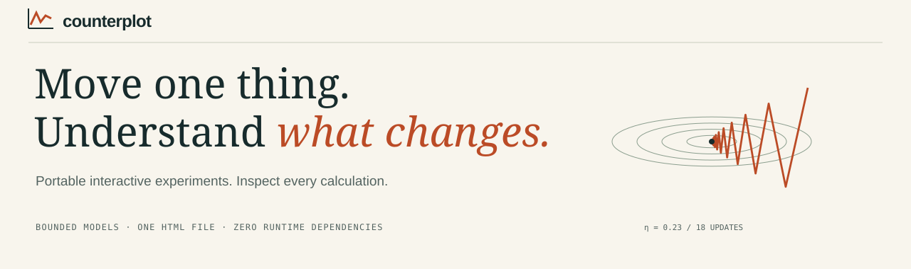
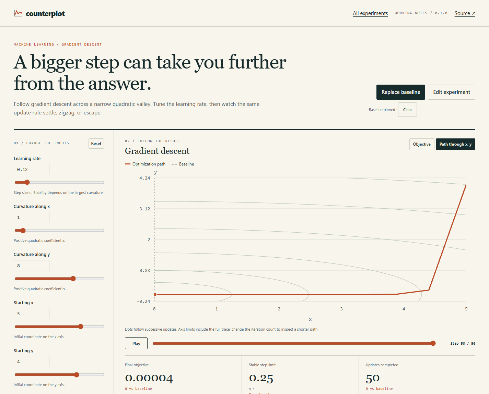

<p align="center"></p>

<p align="center"><strong>Interactive explanations you can calculate, inspect, and send as one file.</strong></p>
<p align="center">Node 20+ · zero runtime dependencies · offline HTML · MIT</p>

Your learning rate looks reasonable. Double it: the optimizer escapes. A hypothetical test is 99% specific. In a rare-condition population, nearly half its positive results are false positives. An extra monthly payment changes the entire repayment curve.

**Counterplot makes these differences something you can explore.** Give it a small JSON experiment. It builds a complete interactive document: inputs, plots, comparisons, computed explanations, numerical tables and exports. Open the file in a browser—even without a server or internet connection.

The same engine calculates the CLI results and the browser plots. Coding agents choose a supported model and write the framing; Counterplot calculates the numbers.

<p align="center"></p>

## Make your first experiment

```bash
git clone https://github.com/owenawsong/Counterplot.git
cd Counterplot
node bin/counterplot.js init descent --out experiment.json
node bin/counterplot.js validate experiment.json
node bin/counterplot.js build experiment.json --out experiment.html
```

**Open `experiment.html` in your browser.** No installation, API key, account or bundler required. Node is only needed to build it; the exported document runs independently.

For the complete example gallery:

```bash
npm run build
npm start
# http://127.0.0.1:18872/
```

## Change an assumption. Keep the evidence.

- **Pin a baseline**, then change an input. Dashed curves and numerical deltas show the comparison.
- **Follow a calculation** with playback and a step scrubber. See the full result and the individual updates.
- **Try named scenarios:** a stable optimizer, the stability boundary, a diverging trace; early or late intervention; a rarer tested population.
- **Inspect the method:** equations, units, assumptions and reference links stay beside the experiment.
- **Keep the result:** CSV, full result JSON, edited experiment JSON, vector chart SVG and browser print/PDF.
- **Make it yours:** edit the JSON inside the document. Validation catches unsupported fields and invalid parameters before they change the calculation.

## Five working model families

| Model | What you can test | Calculation |
| --- | --- | --- |
| `descent` | Learning rate, curvature, start and convergence | Exact gradient updates on a 2D positive quadratic |
| `loan` | Term, nominal rate and extra payments | Monthly amortization, capped final payment |
| `circuit` | Resistance, capacitance and charging direction | Analytical ideal RC step response |
| `epidemic` | Transmission, recovery and intervention timing | SIR equations, fourth-order Runge–Kutta |
| `bayes` | Prevalence, sensitivity and specificity | Expected contingency counts and Bayes’ theorem |

These are deliberately bounded teaching models. A quadratic is not a neural network, an SIR example is not an epidemic forecast, and a loan scenario is not a lender quote. [Equations, verification and limits →](docs/MODELS.md)

## Small spec. Complete artifact.

```json
{
  "schemaVersion": 1,
  "model": "bayes",
  "title": "A positive result is only half the story.",
  "description": "Change prevalence and count both sources of positive results.",
  "parameters": {
    "prevalence": 1,
    "sensitivity": 95,
    "specificity": 99,
    "population": 10000
  },
  "scenarios": [
    {"name": "Ten times rarer", "parameters": {"prevalence": 0.1}}
  ]
}
```

Titles are plain text. Model equations are fixed in source. Specs cannot run JavaScript, supply remote assets or overwrite the model’s units. Unknown fields, out-of-range values and invalid cross-parameter relationships are errors. [Spec reference →](docs/SPEC.md)

## Give your agent a numerical workshop

Point your coding agent at [the included skill](skills/counterplot/SKILL.md). It can inspect available models, write a spec, run validation, export exact values and build a document—without guessing chart data or writing an ad hoc simulator.

> “Use Counterplot to explain why this quadratic’s learning rate oscillates. Include convergent, boundary and divergent scenarios. Check the actual results, then build a portable HTML explanation.”

There is no hosted AI service or model dependency. The skill is readable Markdown with executable CLI steps; install it using your assistant’s normal skill mechanism, or include it directly in the task context. [Agent workflow →](docs/AGENTS.md)

## Scripts, exports and embedding

```bash
node bin/counterplot.js inspect circuit --json
node bin/counterplot.js export examples/circuit.json --format csv --out circuit.csv
node bin/counterplot.js export examples/circuit.json --format json --out circuit-results.json
node bin/counterplot.js compare before.json after.json --out comparison.json
```

Result JSON includes the engine version, normalized engine-source SHA-256, exact spec, canonical spec SHA-256 and computed rows. Browser and CLI use identical provenance envelopes; a pinned baseline adds its own envelope. Builds are deterministic for the same spec and engine source. `compare` requires the same model family; it does not assert that a changed scenario is a controlled causal experiment.

Use the engine directly in Node or an existing frontend:

```js
import {createSpec, evaluate} from './src/engine.js';
const spec = createSpec('circuit');
const result = evaluate(spec, {resistance: 20});
console.log(result.metrics, result.rows);
```

The package exports the engine at its root and the Node HTML builder at `counterplot/render`. The renderer is Node-only; the pure engine uses no Node APIs. [CLI reference →](docs/CLI.md)

## What is verified?

Tests check analytic answers, numerical invariants and failure cases: optimizer recurrence and stability; payment/principal conservation; RC unit conversions; SIR population and final-size invariants; Bayes denominators and undefined events. Integration tests check the CLI, portable output, CSP hashes, invalid specs and local server boundaries.

```bash
npm test
npm ci --ignore-scripts
npm run typecheck
npm run build
npm run check
npm pack
```

CI runs on Windows and Linux with Node 20 and 24. TypeScript declarations include model-specific parameter checks. The only development dependency is the pinned TypeScript compiler; building and running the toolkit needs none. The interface supports keyboard controls, reduced motion and a mobile layout. There is no telemetry or external runtime fetch. **v0.1 is a focused experiment toolkit, not a general equation solver or an independently audited scientific package.**

## Contribute

The best additions are new model families with a useful question, explicit assumptions, meaningful numerical checks and a strong example. [Contribution guide](CONTRIBUTING.md) · [Architecture](docs/ARCHITECTURE.md) · [Release checklist](docs/RELEASE.md) · [Security](SECURITY.md)

Built by [Owen Song](https://github.com/owenawsong), a student developer working on machine learning and useful software. [MIT](LICENSE).
