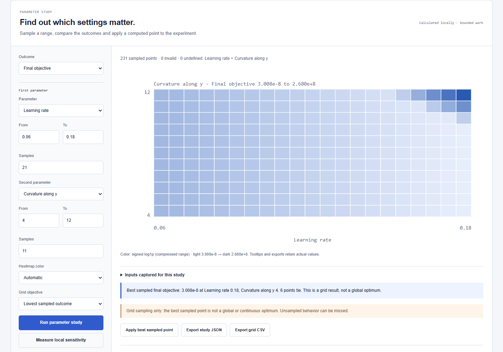

# Counterplot

**A local workbench for parameter studies and classifier evaluation, exported as one interactive HTML file.**

Run a grid of learning rates and curvatures. Inspect a classifier's missed positives and false alarms. Compare a scenario with its baseline—and give someone the complete calculation they can explore themselves.

<p></p>

*An actual 231-point study in Counterplot. Heatmap cells contain computed outcomes; the selected color scale compresses their range while tooltips and exports retain the values.*

**Node 20+ to build · zero runtime dependencies · local processing · MIT**

[Quickstart](#open-your-first-experiment) · [Numerical methods](docs/MODELS.md) · [Study API](docs/ANALYSIS.md) · [Agent skill](skills/counterplot/SKILL.md)

## Open your first experiment

```bash
git clone https://github.com/owenawsong/Counterplot.git
cd Counterplot
node bin/counterplot.js build examples/descent.json --out descent.html
```

Open **`descent.html`** in your browser. It contains the model, controls, plots, study worker and export tools. No install step, server or API key is needed.

Pin a baseline, try the named scenarios, then run a parameter study. You can save the current experiment—including its inputs and pinned baseline—as another HTML file. A recipient can open it offline, change the assumptions and inspect the numerical table. There is no notebook environment or application deployment for them to reproduce.

To browse all six examples from the same checkout:

```bash
npm run build
npm start
# http://127.0.0.1:18872/
```

## A concrete study: when does gradient descent fail?

The quadratic model uses **f(x,y) = ½(ax² + by²)** and exact gradient updates. Convergence from every starting point requires **0 < η < 2/max(a,b)**. With `a = 1` and `b = 8`, that boundary is `η = 0.25`: the steepest coordinate oscillates there, and a larger step can diverge.

The bundled study varies learning rate from `0.02` to `0.30` and y-curvature from `2` to `10`, evaluating **135 sampled combinations** with the other inputs fixed:

```bash
node bin/counterplot.js sweep examples/descent.json --config examples/study-descent.json --out grid.json
node bin/counterplot.js sensitivity examples/descent.json --out sensitivity.json
```

The browser offers the same study as a selectable heatmap. Inspect a cell, compare it with the baseline, or apply the best sampled point to the captured experiment. Study exports record the fixed inputs, exact coordinates, outcome metrics, invalid/undefined points and source fingerprints.

**A sampled grid does not prove a global optimum.** Local sensitivity reports the actual perturbation sizes and boundary handling. Undefined values stay undefined. [Sampling, work limits and interpretation →](docs/ANALYSIS.md)

## Evaluate your own classifier scores

Import a local CSV in the classification workspace:

```csv
label,score
1,0.91
0,0.72
1,0.63
0,0.18
```

Adjust the threshold to see the confusion matrix, precision, recall and F1. Inspect grouped ROC and precision–recall curves, ROC AUC and average precision; sweep thresholds against a metric you choose.

Labels are numeric `0`/`1`, scores are in `[0,1]`, and datasets contain **2–2,000 observations**. Equal-score groups stay together. Scores need not be calibrated probabilities. The bundled data is an **authored teaching fixture**, not measured model predictions. Choosing a threshold on imported labels is tuning on those labels; independent evaluation remains your responsibility.

Your data stays local. Saved HTML and JSON embed the supplied observations, so those files carry the data you choose to share. [Classification definitions and null conventions →](docs/MODELS.md#observed-binary-classification)

## What is included?

| Model | What it calculates |
| --- | --- |
| Classification | Threshold decisions, confusion counts, tied-score ROC/PR, AUC and average precision |
| Gradient descent | Exact updates on a positive 2D quadratic |
| Loan repayment | Fixed-rate monthly amortization and extra payments |
| RC circuit | Analytical ideal capacitor charging or discharge |
| SIR dynamics | Illustrative transmission, recovery and intervention curves |
| Bayesian testing | Expected test outcomes and conditional probabilities |

Every model exposes its equations, units, parameter bounds, assumptions and references. This release supports these six families; it does not accept arbitrary equations, forecast a real epidemic or validate a lender quote. [Methods and verification](docs/MODELS.md)

Across the workbench: baseline overlays, one-/two-parameter grids, local sensitivity, numerical tables and step playback where applicable. Studies run in a local background worker. Controls support keyboard use, including arrow-key study navigation and Enter to apply a point.

**Exports:** interactive HTML, experiment JSON, result/study JSON, numerical CSV, chart SVG and browser print/PDF. Browser and CLI share the numerical implementation and provenance schema. Raw floating-point results can differ in their last digits across runtimes. [Spec and provenance](docs/SPEC.md) · [CLI/API reference](docs/CLI.md)

## For coding agents and other applications

[The included agent skill](skills/counterplot/SKILL.md) guides an assistant through choosing a supported model, validating inputs, inspecting computed results and building a portable explanation. There is no hosted AI service or model subscription in the toolkit.

The pure numerical engine is available at `counterplot`, study functions at `counterplot/analysis`, and the Node HTML builder at `counterplot/render` when installed from a locally built package. Model-specific TypeScript declarations are included. [Worked agent workflow](docs/AGENTS.md) · [Architecture](docs/ARCHITECTURE.md)

## Verification and contributions

**42 tests** cover analytical answers, numerical invariants, classifier ties and undefined cases, study bounds, immutable inputs, provenance and CLI/portable-file integration. CI checks Node 20/24 on Windows and Linux.

```bash
npm ci --ignore-scripts
npm test
npm run typecheck
npm run build
npm run check
```

The package makes no external runtime requests and includes no telemetry. Tests and fingerprints provide inspectable evidence; they are not an independent scientific audit.

Contributions should bring a useful question, explicit assumptions, a verifiable calculation and a revealing example. [Contributing](CONTRIBUTING.md) · [Release checklist](docs/RELEASE.md) · [Security](SECURITY.md) · [MIT license](LICENSE)

Built by [Owen Song](https://github.com/owenawsong), a student developer working on machine learning and useful software.
